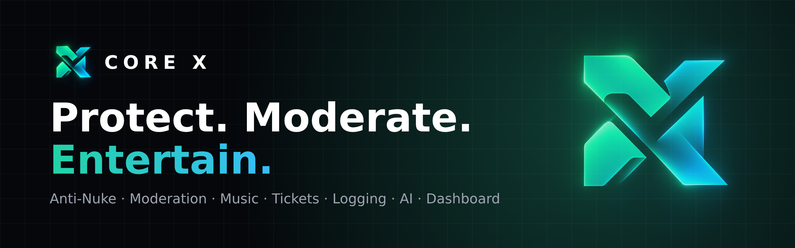
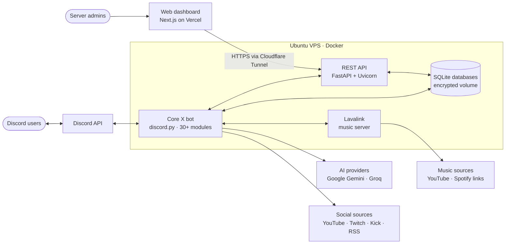

<div align="center">



# Core X

**All-in-one Discord bot: Anti-Nuke security, moderation, music, tickets, logging, leveling, AI and more, with a web dashboard.**

[](https://corexpanel.vercel.app)
[](https://discord.gg/AsEy3tRUBx)


[Features](#-features) · [Getting started](#-getting-started) · [Security setup](#%EF%B8%8F-security-setup-anti-nuke) · [Integrations](#-integrations) · [Architecture](#%EF%B8%8F-architecture) · [Tech stack](#-tech-stack) · [Commands](#-commands) · [FAQ](#-faq)

</div>

---

## ✨ Features

| | |
|---|---|
| 🛡️ **Anti-Nuke** | Bans attackers within a second and restores deleted channels and roles. Covers bans, unbans, kicks, prunes, channels, roles, webhooks, bots, @everyone and server edits. |
| 🧱 **Core Wall & Supreme lock** | Core X's own security roles. Only Core X can hold `Core X Supreme™`, and anyone else who gets it loses it instantly. |
| 🚫 **Anti-Scam** | Detects scam images spread by hacked accounts (image fingerprints plus an AI check), deletes them and times the sender out. |
| 🔨 **Moderation** | Ban, kick, mute, warn, lock, hide, purge with `.txt` transcripts, mass roles with safety rules, and more. |
| 🤖 **Automod** | Anti-spam, anti-caps, anti-link, anti-invite, mass-mention, blacklisted words and media-only channels. |
| 📜 **Logging** | Messages (including deleted images, videos and audio), members, roles, channels, voice, moderation and server changes. |
| 🎫 **Tickets & ✅ Verification** | Button panels, claims, transcripts and verification panels. |
| 👋 **Welcomer** | Welcome and goodbye cards, Join DM, Auto-Nickname with your server tag. |
| 📈 **Leveling & 📨 Invites** | XP, rank cards, level rewards and invite tracking with leaderboards. |
| 🔔 **Social Notify** | Instant alerts for YouTube videos, Shorts and lives, plus Twitch, Kick and more. |
| 🎵 **Music** | High-quality playback through Lavalink: YouTube, Spotify links, filters, autoplay and 24/7 mode. |
| 🧠 **AI** | Ask, summarize, explain code, roleplay and image generation. |
| 🎉 **Fun & 🎮 Games** | Hug, kill, ship, roast, plus chess, wordle, 2048, blackjack, battleship and more. |
| 🖥️ **Web dashboard** | Manage almost every module from **[corexpanel.vercel.app](https://corexpanel.vercel.app)** without typing commands. |

---

## 🚀 Getting started

1. **Invite Core X** from the dashboard: **[corexpanel.vercel.app](https://corexpanel.vercel.app)** → *Invite*. Keep the requested permissions so every module works.
2. **Move the Core X role up.** In *Server Settings → Roles*, drag `Core X` into the **top 4 roles**. Core X can only act on members whose roles are below it.
3. **Type `.help`** in any channel. Pick a category from the menu to see its commands.
4. **Open the dashboard**, log in with Discord and choose your server to configure modules with buttons and forms.

> **Prefix:** `.` (for example `.help`, `.play`, `.ban @user`). Many commands also work as `/` slash commands.

---

## 🛡️ Security setup (Anti-Nuke)

Do this first in every server.

```
.antinuke enable
```

Core X creates **Core X Supreme™** and **Core Wall**, positions them right below its own role, and switches protection on.

**Who is trusted**

| Who | How | What they can do |
|---|---|---|
| Server owner | automatic | Everything |
| Extra owners | `.extraowner set @user` | Act like the owner for Anti-Nuke, and manage the whitelist |
| Whitelisted members | `.whitelist @user` and pick actions | Only the actions you allow (ban, kick, channels, roles, ...) |
| Everyone else | — | Any protected action gets them **banned** and the damage undone |

**Built-in protection rules**

- Banning or unbanning without whitelist → the person is banned and the ban or unban is reversed. This also applies when someone uses Core X's own `.ban` or `.unban`.
- A whitelisted member who **leaves the server loses the whitelist** automatically, and is a normal member if they join back.
- Auto-roles and mass role commands (`.role humans`, `.role all`, ...) **refuse admin or dangerous roles**.
- `Core X Supreme™` can only be held by Core X.
- Optional: `.nightmode enable` (strips dangerous permissions from roles) and `.walllock on`.

> ⚠️ Keep the `Core X` role **above** your admin roles. Core X can't punish anyone whose role is higher than its own.

---

## 🔗 Integrations

| Integration | What it does | How to use |
|---|---|---|
| 🖥️ **Web dashboard** | Configure Anti-Nuke, Automod, Logging, Tickets, Welcomer, Leveling, Notify, Music and more | [corexpanel.vercel.app](https://corexpanel.vercel.app) → log in with Discord |
| ▶️ **YouTube** | New videos, Shorts and live streams announced within about a minute | `.notify panel` → add a channel link |
| 🟣 **Twitch** | Live stream alerts | `.notify panel` → Twitch |
| 🟢 **Kick** | Live stream alerts | `.notify panel` → Kick |
| 📸 **Instagram / RSS** | New posts from an RSS feed | `.notify panel` → RSS |
| 🎵 **Spotify** | Play Spotify tracks, albums and playlists | `.play <spotify link>` |
| 🎧 **Lavalink** | Music engine for clear audio and filters | Works automatically; `.join`, `.play` |
| 🧠 **Google Gemini & Groq AI** | AI chat, summaries, code help and the Anti-Scam AI check | `.ai ask <question>`, `.antiscam on` |
| 🖼️ **AI images** | Generate images from a prompt | `/imagine <prompt>` |
| ⛏️ **Minecraft** | Live Minecraft server status | `.minecraft setup` |

---

## 🏗️ Architecture



**How it fits together**

- **Core X bot** connects to Discord and runs every module (Anti-Nuke, moderation, music and the rest) as separate cogs that load at startup.
- **REST API** runs in the same process as the bot. The dashboard uses it to read and change each server's settings, so changes apply instantly without a restart.
- **Web dashboard** is a Next.js app on Vercel. Admins log in with Discord OAuth and only see the servers they manage.
- **Cloudflare Tunnel** carries traffic between the dashboard and the API, so the VPS opens no public ports.
- **SQLite databases** store each server's settings on an encrypted volume on the VPS.
- **Lavalink** is a separate audio server that streams music to voice channels.
- **YouTube alerts** arrive instantly through WebSub push notifications, with a channel check every few minutes as a backup.

---

## 🧰 Tech stack

| Layer | Technology |
|---|---|
| Language | Python 3.13 |
| Discord library | discord.py 2.7 (Components V2 cards, buttons, slash and prefix commands) |
| API | FastAPI · Uvicorn · Pydantic · SlowAPI (rate limiting) |
| Database | SQLite through aiosqlite |
| Music | Lavalink v4 · Wavelink 3 |
| AI | Google Gemini (google-genai) · Groq (OpenAI-compatible SDK) |
| Images | Pillow · NumPy (cards, banners, Anti-Scam image fingerprints) |
| Networking | aiohttp · httpx · WebSub push notifications |
| Language tools | deep-translator · langdetect · gTTS |
| Dashboard | Next.js · React · TypeScript · Tailwind CSS · hosted on Vercel |
| Hosting | Ubuntu VPS · Docker · PM2 · Cloudflare Tunnel |
| Testing | pytest · pytest-asyncio |

---

## 📚 Commands

Prefix `.` — **447+ commands** in 30 categories. Click a category to open it.

<details>
<summary><b>🛡️ Security</b> — 29 commands</summary>
<br>

`.antinuke` · `.antinuke enable` · `.antinuke disable` · `.an enable` · `.an disable` · `.whitelist` · `.whitelist @user` · `.unwhitelist` · `.whitelisted` · `.whitelist reset` · `.extraowner` · `.extraowner set` · `.extraowner view` · `.extraowner reset` · `.nightmode` · `.nightmode enable` · `.nightmode disable` · `.walllock` · `.walllock on` · `.walllock off` · `.antiscam` · `.antiscam on` · `.antiscam off` · `.antiscam block` · `.antiscam unblock` · `.antiscam timeout <minutes>` · `.antiscam log #channel` · `.antiscam dm on/off` · `.antiscam ignore #channel/@role`

</details>

<details>
<summary><b>🔨 Moderation</b> — 54 commands</summary>
<br>

`.audit` · `.warn` · `.clearwarns` · `.ban` · `.clone` · `.snipe` · `.hide` · `.hideall` · `.kick` · `.lock` · `.mute` · `.nick` · `.nuke` · `.role` · `.role add` · `.role remove` · `.roleicon` · `.role all` · `.role bots` · `.role create` · `.role delete` · `.role humans` · `.role rename` · `.role temp` · `.role unverified` · `.slowmode` · `.lockall` · `.unlockall` · `.steal` · `.unban` · `.unhide` · `.unhideall` · `.unlock` · `.unslowmode` · `.removerole all` · `.removerole bots` · `.removerole humans` · `.removerole unverified` · `.clear` · `.clear all` · `.clear bots` · `.clear contains` · `.clear embeds` · `.clear files` · `.clear images` · `.clear mentions` · `.clear reactions` · `.clear user` · `.deleteemoji` · `.deletesticker` · `.enlarge` · `.topcheck` · `.topcheck enable` · `.topcheck disable`

</details>

<details>
<summary><b>🤖 Automod</b> — 22 commands</summary>
<br>

`.automod` · `.automod enable` · `.automod disable` · `.automod punishment` · `.autmod config` · `.automod logging` · `.automod ignore` · `.automod ignore channel` · `.automod ignore role` · `.automod ignore show` · `.automod ignore reset` · `.automod unignore` · `.automod unignore channel` · `.automod unignore role` · `.blacklistword` · `.blacklistword add <word>` · `.blacklistword remove <word>` · `.blacklistword reset` · `.blacklistword config` · `.blacklistword bypass add <user/role>` · `.blacklistword bypass remove <user/role>` · `.blacklistword bypass show`

</details>

<details>
<summary><b>📜 Logging</b> — 7 commands</summary>
<br>

`.log` · `.log enable` · `.log disable` · `.log config` · `.log ignore` · `.log status` · `.log toggle`

</details>

<details>
<summary><b>✅ Verification</b> — 8 commands</summary>
<br>

`.verification setup` · `.verification status` · `.verification enable` · `.verification disable` · `.verification logs` · `.verification reset` · `.verification verify` · `.verification fix`

</details>

<details>
<summary><b>🎫 Ticket</b> — 10 commands</summary>
<br>

`.ticket panel` · `.ticket send` · `.ticket close` · `.ticket claim` · `.ticket lock` · `.ticket unlock` · `.ticket add` · `.ticket remove` · `.ticket rename` · `.ticket transcript`

</details>

<details>
<summary><b>👋 Welcomer</b> — 10 commands</summary>
<br>

`.greet panel` · `.greet goodbye` · `.greet test` · `.greet autodelete` · `.greet reset` · `.autonick` · `.autonick set <your tag>` · `.autonick apply` · `.autonick keep on/off` · `.autonick off`

</details>

<details>
<summary><b>⚙️ Server</b> — 37 commands</summary>
<br>

`.setup` · `.setup create <name>` · `.setup delete <name>` · `.setup list` · `.setup staff` · `.setup girl` · `.setup friend` · `.setup vip` · `.setup guest` · `.setup config` · `.setup reset` · `.staff` · `.girl` · `.friend` · `.vip` · `.guest` · `.autorole bots add` · `.autorole bots remove` · `.autorole bots` · `.autorole config` · `.autorole humans add` · `.autorole humans remove` · `.autorole humans` · `.autorole reset all` · `.autorole reset bots` · `.autorole reset humans` · `.autorole` · `.autoresponder` · `.autoresponder create` · `.autoresponder delete` · `.autoresponder edit` · `.autoresponder config` · `.react` · `.react add` · `.react remove` · `.react list` · `.react reset`

</details>

<details>
<summary><b>📨 Invite Tracker</b> — 7 commands</summary>
<br>

`.invpanel` · `.invites` · `.invlb` · `.addinvites` · `.removeinvites` · `.setinvites` · `.resetinvites`

</details>

<details>
<summary><b>📈 Leveling</b> — 32 commands</summary>
<br>

`.level status` · `.level channel` · `.level message` · `.level desc` · `.level color` · `.level thumbnail` · `.level image` · `.level clearimage` · `.level xprange` · `.level multiplier` · `.level addreward` · `.level removereward` · `.level rewards` · `.level setxp` · `.level preview` · `.level xpboost` · `.level xpboost add` · `.level xpboost remove` · `.level xpboost list` · `.level blacklist` · `.level blacklist channel` · `.level blacklist role` · `.level unblacklist` · `.level unblacklist channel` · `.level unblacklist role` · `.level stats` · `.level leaderboard` · `.level reset` · `.level reset user` · `.level reset all` · `.level placeholders` · `.level rank`

</details>

<details>
<summary><b>🎁 Giveaway</b> — 6 commands</summary>
<br>

`.gpanel` · `.gstart <time> <winners> <prize>` · `.gend` · `.gcancel` · `.greroll` · `.glist`

</details>

<details>
<summary><b>🔔 Social Notify</b> — 1 commands</summary>
<br>

`.notify panel`

</details>

<details>
<summary><b>🎵 Music</b> — 23 commands</summary>
<br>

`.play` · `.search` · `.loop` · `.autoplay` · `.nowplaying` · `.shuffle` · `.stop` · `.skip` · `.seek` · `.join` · `.disconnect` · `.replay` · `.queue` · `.clearqueue` · `.pause` · `.resume` · `.volume` · `.filter` · `.filter enable` · `.filter disable` · `.247` · `.247 on` · `.247 off`

</details>

<details>
<summary><b>🔊 Voice</b> — 22 commands</summary>
<br>

`.voice` · `.voice kick` · `.voice kickall` · `.voice mute` · `.voice muteall` · `.voice unmute` · `.voice unmuteall` · `.voice deafen` · `.voice deafenall` · `.voice undeafen` · `.voice undeafenall` · `.voice move` · `.voice moveall` · `.voice pull` · `.voice pullall` · `.voice lock` · `.voice unlock` · `.voice private` · `.voice unprivate` · `.vcrole add` · `.vcrole remove` · `.vcrole config`

</details>

<details>
<summary><b>🎙️ J2C</b> — 2 commands</summary>
<br>

`.j2csetup` · `.j2creset`

</details>

<details>
<summary><b>🧠 AI</b> — 16 commands</summary>
<br>

`.ai activate` · `.ai deactivate` · `.ai analyze` · `.ai analyse` · `.ai code` · `.ai explain` · `.ai conversation-clear` · `.ai mood-analyzer` · `.ai personality` · `.ai conversation-stats` · `.ai summarize` · `.ai ask` · `.ai fact` · `.ai database-clear` · `.ai roleplay-enable` · `.ai roleplay-disable`

</details>

<details>
<summary><b>🎉 Fun</b> — 22 commands</summary>
<br>

`./imagine` · `.ship` · `.hug` · `.kiss` · `.pat` · `.cuddle` · `.slap` · `.kill` · `.tickle` · `.8ball` · `.coinflip` · `.dice` · `.roast` · `.iq` · `.dumb` · `.simprate` · `.toxic` · `.intelligence` · `.genius` · `.brainrate` · `.howhot` · `.nitro`

</details>

<details>
<summary><b>🎮 Games</b> — 14 commands</summary>
<br>

`.blackjack` · `.chess` · `.tic-tac-toe` · `.country-guesser` · `.rps` · `.lights-out` · `.wordle` · `.2048` · `.memory-game` · `.number-slider` · `.battleship` · `.connect-four` · `.slots` · `.counting`

</details>

<details>
<summary><b>⭐ General</b> — 27 commands</summary>
<br>

`.status` · `.afk` · `.avatar` · `.banner` · `.servericon` · `.membercount` · `.poll` · `.hack` · `.token` · `.users` · `.wizz` · `.urban` · `.rickroll` · `.hash` · `.snipe` · `.list boosters` · `.list inrole` · `.list emojis` · `.list bots` · `.list admins` · `.list invoice` · `.list mods` · `.list early` · `.list activedeveloper` · `.list createpos` · `.list roles` · `.calculator`

</details>

<details>
<summary><b>🧰 Utility</b> — 30 commands</summary>
<br>

`.botinfo` · `.stats` · `.invite` · `.serverinfo` · `.userinfo` · `.roleinfo` · `.boostcount` · `.unbanall` · `.joined-at` · `.ping` · `.github` · `.vcinfo` · `.channelinfo` · `.badges` · `.banner user` · `.banner server` · `.reminder start` · `.reminder clear` · `.permissions` · `.timer` · `.media` · `.media setup` · `.media remove` · `.media config` · `.media bypass` · `.media bypass add` · `.media bypass remove` · `.media bypass show` · `.panel` · `.embed`

</details>

<details>
<summary><b>🎂 Birthday</b> — 5 commands</summary>
<br>

`.birthdaysetup` · `.setbirthday` · `.removebirthday` · `.listbirthdays` · `.birthday`

</details>

<details>
<summary><b>💎 Boost</b> — 5 commands</summary>
<br>

`.boost setup` · `.boost message` · `.boost channel` · `.boostrole` · `.boost config`

</details>

<details>
<summary><b>🔢 Counting</b> — 5 commands</summary>
<br>

`.counting` · `.counting enable/disable` · `.counting channel #channel` · `.counting stats` · `.counting config continue/reset`

</details>

<details>
<summary><b>📌 Sticky</b> — 4 commands</summary>
<br>

`.sticky setup` · `.sticky edit` · `.sticky list` · `.sticky remove`

</details>

<details>
<summary><b>🔗 Vanity</b> — 3 commands</summary>
<br>

`.vanityroles setup` · `.vanityroles reset` · `.vanityroles show`

</details>

<details>
<summary><b>✉️ Joindm</b> — 4 commands</summary>
<br>

`.joindm enable` · `.joindm disable` · `.joindm message` · `.joindm test`

</details>

<details>
<summary><b>🙈 Ignore</b> — 13 commands</summary>
<br>

`.ignore` · `.ignore command add` · `.ignore command remove` · `.ignore command show` · `.ignore channel add` · `.ignore channel remove` · `.ignore channel show` · `.ignore user add` · `.ignore user remove` · `.ignore user show` · `.ignore bypass add` · `.ignore bypass show` · `.ignore bypass remove`

</details>

<details>
<summary><b>⛏️ Minecraft</b> — 3 commands</summary>
<br>

`.minecraft setup` · `.minecraft reset` · `.minecraft status`

</details>

<details>
<summary><b>🔐 Encryption</b> — 22 commands</summary>
<br>

`.encode base32` · `.encode b32` · `.encode base64` · `.encode b64` · `.encode rot13` · `.encode r13` · `.encode hex` · `.encode base85` · `.encode b85` · `.encode ascii85` · `.encode a85` · `.decode base32` · `.decode b32` · `.decode base64` · `.decode b64` · `.decode rot13` · `.decode r13` · `.decode hex` · `.decode base85` · `.decode b85` · `.decode ascii85` · `.decode a85`

</details>

<details>
<summary><b>👤 Bot Profile</b> — 4 commands</summary>
<br>

`.botprofile` · `.botprofile avatar` · `.botprofile banner` · `.botprofile reset`

</details>

> Owner-only and developer commands are not listed.

---

## 🧭 Quick examples

```
.antinuke enable              # turn on server protection
.whitelist @Krazy             # trust a member for chosen actions
.ban @user spamming           # ban with a reason
.clear 50                     # delete 50 messages (saved as .txt in logs)
.log enable                   # set up logging channels
.ticket panel                 # create a ticket panel
.greet panel                  # set up welcome messages
.autonick set Core |          # new members become "Core | Krazy"
.notify panel                 # YouTube / Twitch / Kick alerts
.play never gonna give you up # play music
.ai ask what is anti-nuke?    # ask the AI
```

---

## ❓ FAQ

<details><summary><b>Core X didn't ban the attacker</b></summary><br>
The attacker's role was above Core X's role. Move <code>Core X</code> into the top 4 roles and above every admin role.
</details>

<details><summary><b>How do I give someone permission to ban?</b></summary><br>
<code>.whitelist @user</code> and choose <b>Ban</b>. Ban permission also covers unban.
</details>

<details><summary><b>Music stopped after a restart</b></summary><br>
Use <code>.247 on</code>. Core X follows you to your voice channel and comes back after restarts.
</details>

<details><summary><b>Where are deleted images saved?</b></summary><br>
In your message log channel, if you turned on <i>Logging → Deleted messages</i> in the dashboard.
</details>

---

## 💬 Support

- **Support server:** [discord.gg/AsEy3tRUBx](https://discord.gg/AsEy3tRUBx)
- **Dashboard:** [corexpanel.vercel.app](https://corexpanel.vercel.app)

<div align="center">

Made with ❤️ by **Team Forge Management** · © 2025 CoreXDev

</div>
