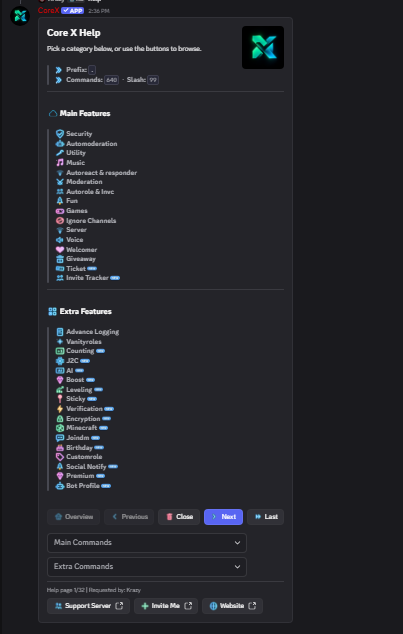
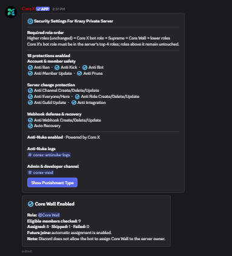
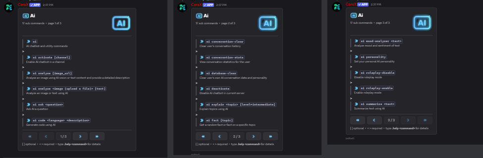
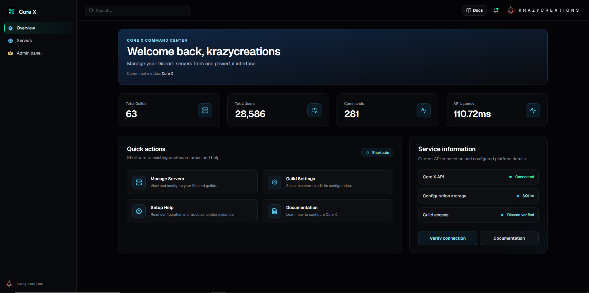

<h1 align="center">Core X</h1>

<p align="center">
  <b>An all-in-one Discord bot for security, moderation, AI and community management, with its own web dashboard.</b>
</p>

<p align="center">
  
  
  
  
</p>

<p align="center">
  <a href="https://discord.com/oauth2/authorize?client_id=1427610501516361779&permissions=8&scope=bot+applications.commands">➕ Invite Core X</a> ·
  <a href="https://discord.gg/AsEy3tRUBx">💬 Support Server</a> ·
  <a href="https://core-x-psi.vercel.app/dashboard">📊 Dashboard</a>
</p>

> 🔒 **The source code is private.** This repository is a project showcase. A live demo and code walkthrough are available on request.

---

## ✨ Highlights

- 🛡️ **Anti-Nuke protection**: 18 protections stop raids and rogue admins (mass bans, kicks, bot adds, channel/role/webhook changes) and **automatically recover** the server
- 🤖 **AI suite**: 17 AI commands for chat, image analysis, code generation, summaries, explanations and personalities
- 🧰 **600+ commands** (prefix + 99 slash commands) across 30+ modules
- 📊 **Web dashboard** to manage servers and settings from the browser
- ⚡ Running live in **60+ servers with 28,000+ users**

## 📸 Screenshots

### Help menu: 30+ feature categories


### Anti-Nuke security settings


### AI commands


### Web dashboard


## 🧩 Features

| Category | What it does |
|---|---|
| **Security & Anti-Nuke** | Anti ban/kick/prune, anti bot add, channel/role/webhook/guild protection, @everyone protection, auto recovery, punishment types, logs |
| **Moderation & Automod** | Moderation commands, auto-moderation, verification, advanced logging |
| **AI** | Chatbot channels, ask, code, explain, summarize, image analysis, mood analysis, custom personalities, roleplay mode, conversation memory |
| **Community** | Welcomer, autoroles, reaction roles, tickets, giveaways, leveling, birthdays, counting, invite tracker, join-to-create voice |
| **Utility & Fun** | Music, games, sticky messages, custom roles, vanity roles, social notifications, Minecraft tools |
| **Premium** | Premium features and custom bot profile |

## 🏗️ Architecture

```
 Discord users
      │
      ▼
 ┌──────────────┐      ┌──────────────────────────────┐
 │ Core X (py)  │ ───► │  AI providers                │
 │ (Ubuntu VPS) │      │  Groq · Gemini · Cloudflare  │
 └──────┬───────┘      │  Workers AI · Pollinations   │
        │              └──────────────────────────────┘
        ▼
 ┌──────────────┐      ┌──────────────────────────────┐
 │ SQLite config│ ◄─── │  Web dashboard (Vercel)      │
 │  & Core X API│      │  Discord login · server mgmt │
 └──────────────┘      └──────────────────────────────┘
```

## 🛠️ Tech stack

- **Bot:** Python 3.13, discord.py 2.7
- **API:** FastAPI (Core X API powering the dashboard)
- **Music:** Lavalink
- **Deployment:** Docker
- **AI:** Groq and Gemini (chat, code), Cloudflare Workers AI (premium images), Pollinations (images)
- **Data:** SQLite
- **Dashboard:** deployed on Vercel from GitHub, with Discord OAuth login
- **Hosting:** Docker on an Ubuntu VPS, with a custom domain on Cloudflare

## 💼 Want a bot like this?

I build custom Discord bots, dashboards and AI integrations for communities and businesses.
Contact me via my [GitHub profile](https://github.com/vishnurdev).
